# Book-in — Sistem Booking Ruang Meeting

Book-in adalah aplikasi internal untuk melihat dan memesan ruang rapat kantor. Worker masuk dengan Clerk, mencari ruangan, memilih jadwal pada kalender/timeline, lalu melihat pemesanannya di Riwayat. Admin menggunakan menu khusus **Kelola Ruangan** untuk membuat, mengubah, dan menghapus ruangan.

Ruang rapat adalah fasilitas internal kantor tanpa biaya sewa. Karena itu field harga, kalkulasi harga, kolom biaya, dan paket konsumsi sengaja tidak ada di antarmuka, API, maupun database.

## Screenshot

### Alur Booking Worker (Stepper)

Empat langkah: **Ruangan → Tanggal & Jam → Data Pemesan → Konfirmasi**, lalu Sukses.

| 1. Ruangan                                                                      | 2. Tanggal & Jam                                                    |
| ------------------------------------------------------------------------------- | ------------------------------------------------------------------- |
| 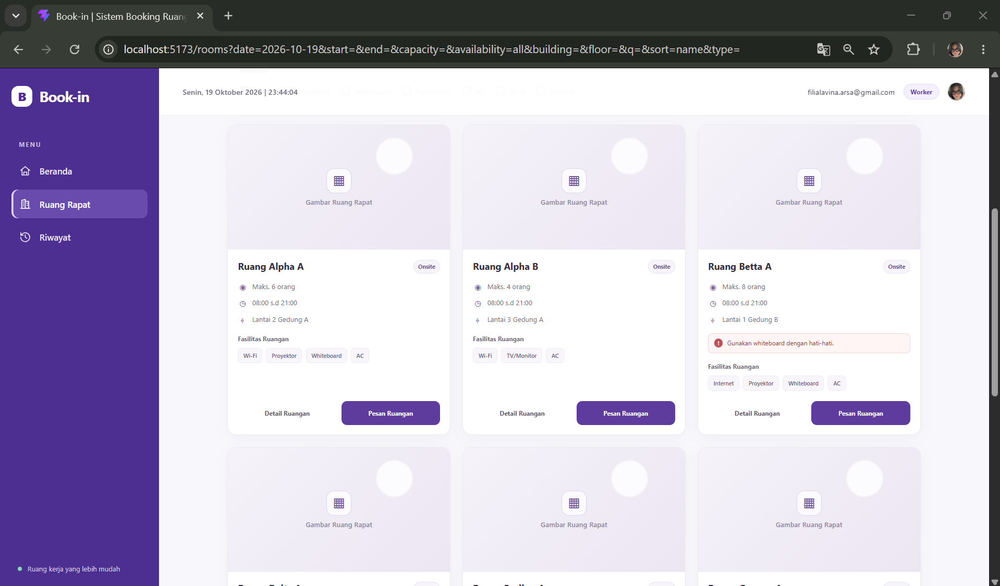 | 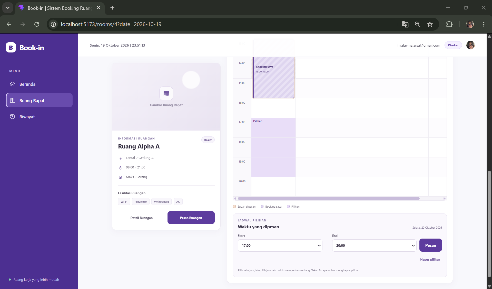 |

| 3. Data Pemesan & 4. Konfirmasi                                                   | Sukses                                                                              |
| --------------------------------------------------------------------------------- | ----------------------------------------------------------------------------------- |
| 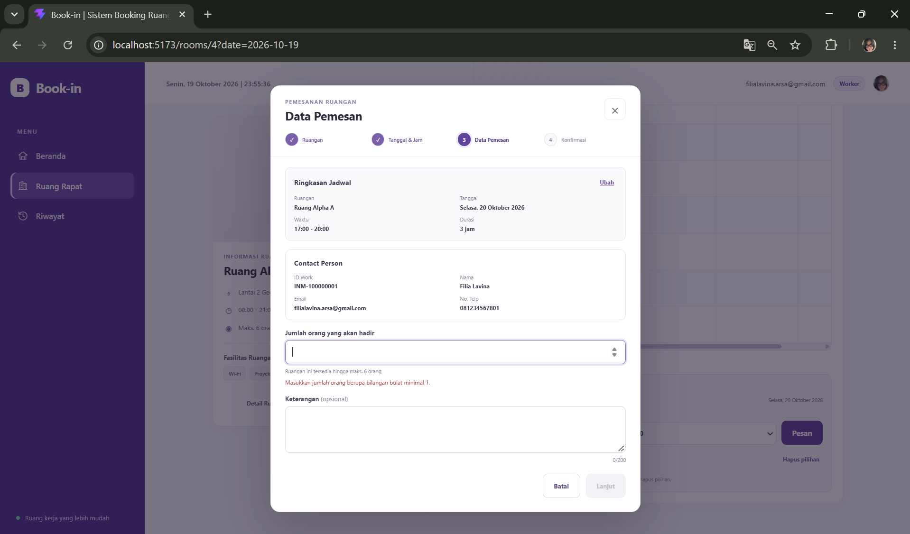 | 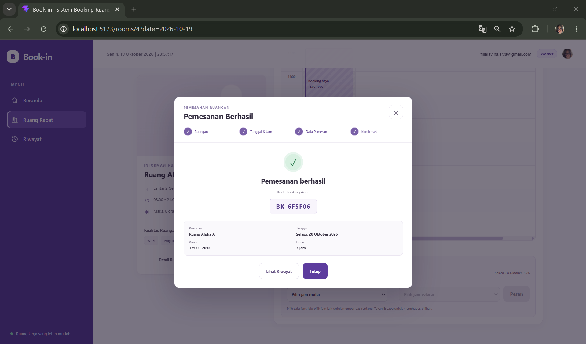 |

### Halaman Worker Lainnya

| Sign-in (Clerk)                                          | Beranda                                                         |
| -------------------------------------------------------- | --------------------------------------------------------------- |
| 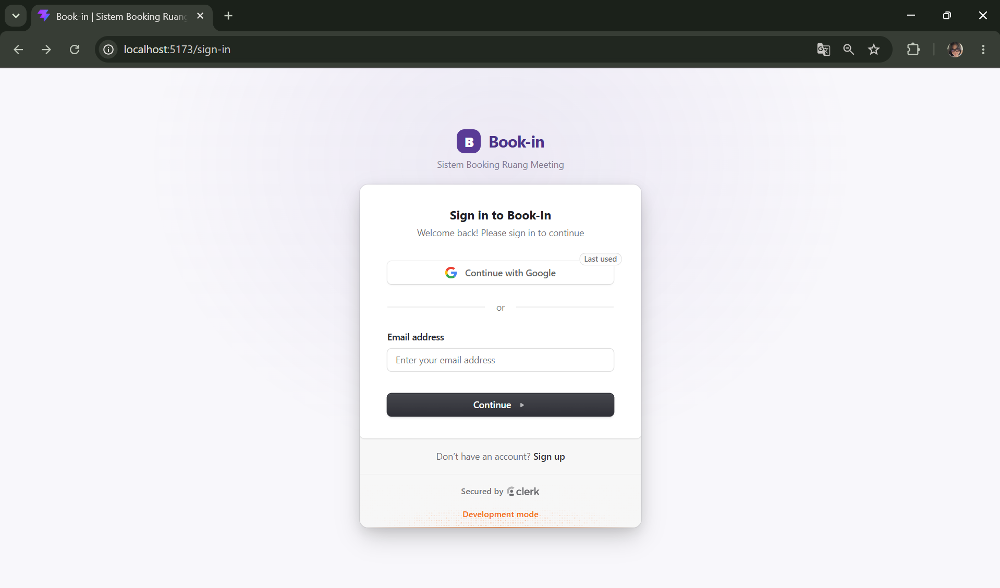 |  |

| Filter Ruang Rapat                                          | Filter aktif (Tersedia / Tidak tersedia)                                |
| ----------------------------------------------------------- | ----------------------------------------------------------------------- |
| 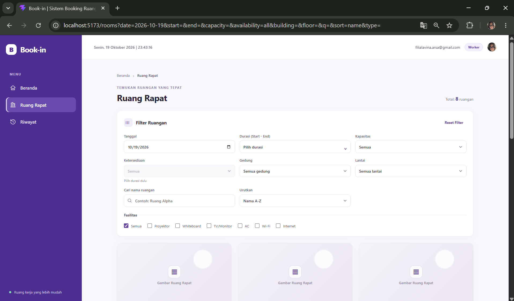 | 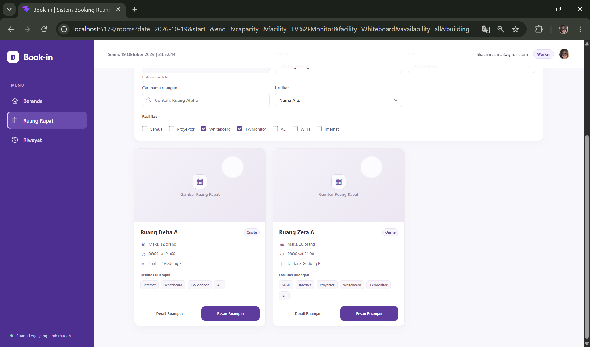 |

| Detail ruangan & kalender                                                           | Timeline                                                                    |
| ----------------------------------------------------------------------------------- | --------------------------------------------------------------------------- |
| 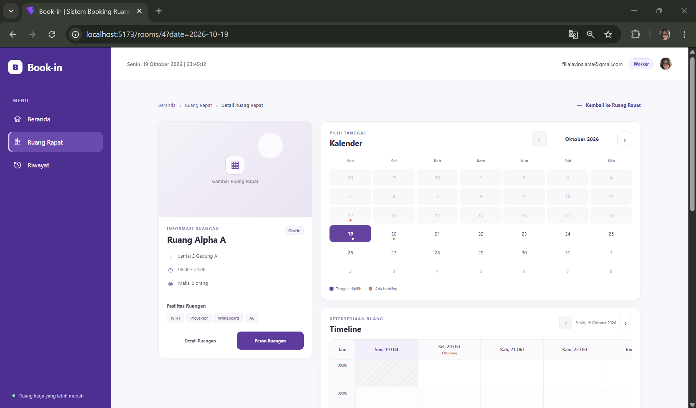 | 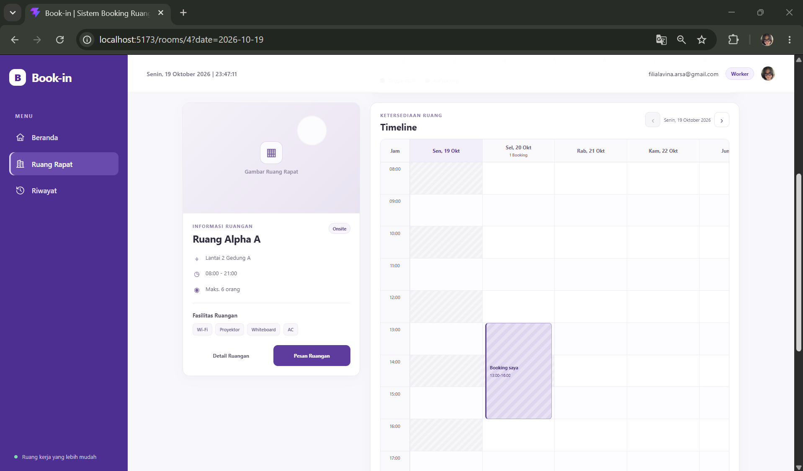 |

#### Riwayat Pemesanan

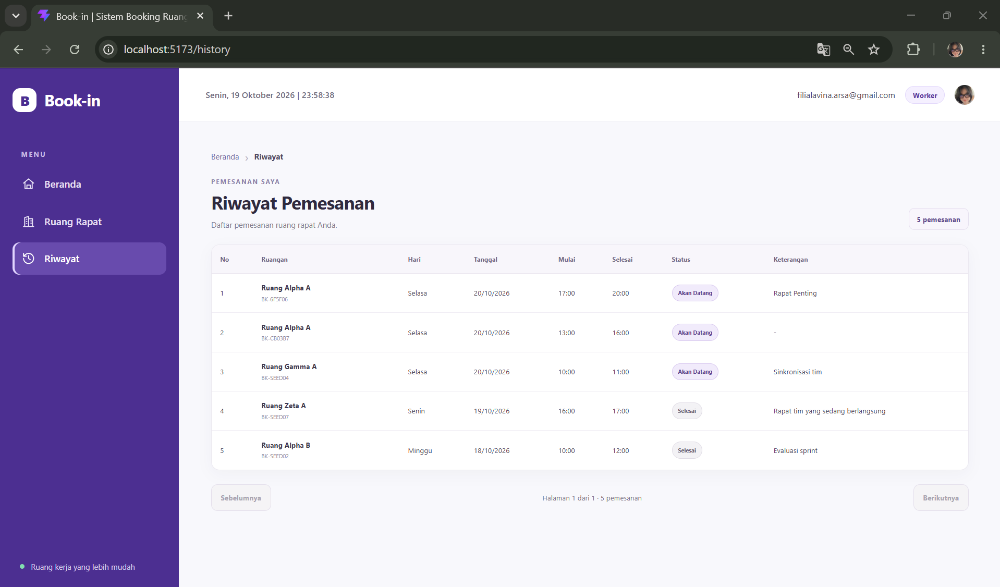

### Alur Admin

| Beranda Admin                                                | Kelola Ruangan                                                                 |
| ------------------------------------------------------------ | ------------------------------------------------------------------------------ |
| 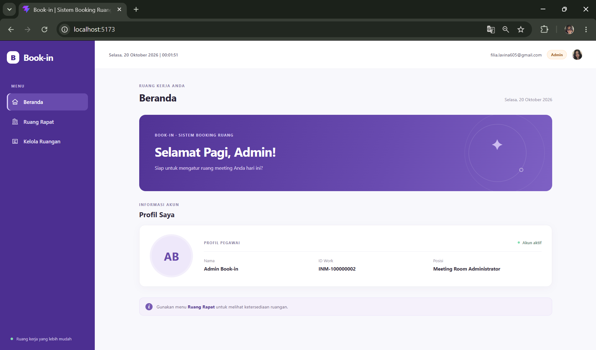 | 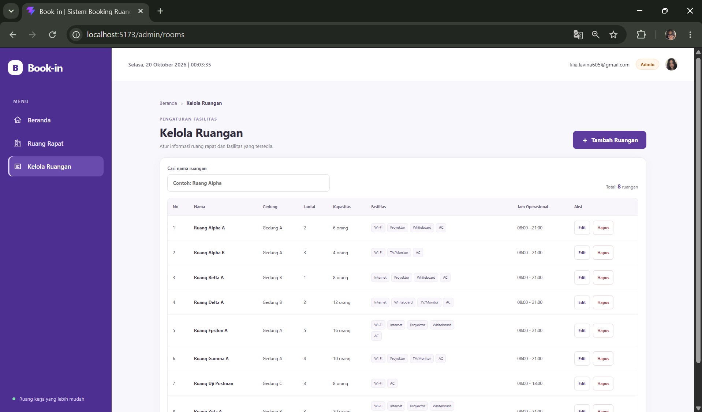 |

| Tambah Ruangan                                                     | Edit Ruangan                                                          |
| ------------------------------------------------------------------ | --------------------------------------------------------------------- |
| 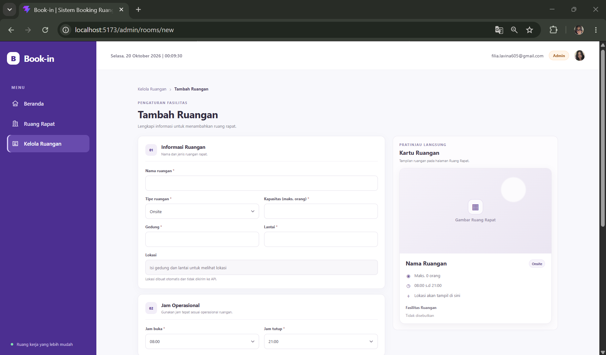 | 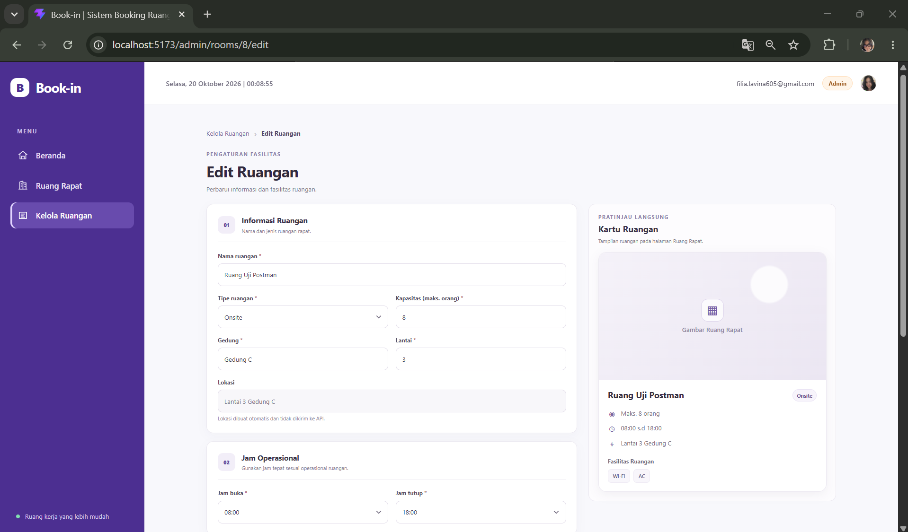 |

### Tampilan Mobile (360 px)

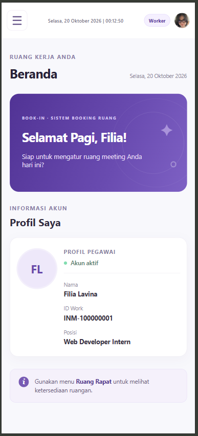

### Dokumentasi API

- Ringkasan endpoint: [`docs/api.md`](docs/api.md)
- Postman collection: [`docs/postman/`](docs/postman/)

## Teknologi

Versi di bawah mengikuti rentang versi yang dideklarasikan pada `package.json` masing-masing; dependency lockfile menyimpan resolusi instalasi.

| Bagian   | Teknologi dan versi                                                                                                                                                    |
| -------- | ---------------------------------------------------------------------------------------------------------------------------------------------------------------------- |
| Frontend | React `^19.2.8`, React DOM `^19.2.8`, Vite `^8.3.0`, TypeScript `~6.0.2`, React Router `^7.18.4`, Clerk React `^6.17.8`                                                |
| Backend  | Node.js + Express `^5.3.0`, TypeScript `^6.0.3`, Prisma CLI/Client `^7.10.1`, Prisma PostgreSQL adapter `7.10.1`, `pg` `8.23.1`, Zod `^4.6.7`, Clerk Express `^2.1.80` |
| Testing  | Vitest `^5.0.5`; ESLint `^10.10.0` pada frontend                                                                                                                       |

Node.js yang sesuai dengan Vite dan Prisma: `^20.19`, `^22.12`, atau `^24.0`. Runtime yang digunakan saat pemeriksaan repository ini adalah Node `v24.12.0`.

## Struktur repository

```text
/
├── backend/       # Express API, Prisma schema/migrations, seeder
├── frontend/      # React app
├── docs/
│   ├── api.md
│   ├── postman/
│   └── screenshots/
├── PRD.md
└── README.md
```

- [README Backend](backend/README.md)
- [README Frontend](frontend/README.md)
- [Dokumentasi API lengkap](docs/api.md)
- [Koleksi Postman v2.1](docs/postman/book-in.postman_collection.json)

## Prasyarat

- Git.
- Node.js `^20.19`, `^22.12`, atau `^24.0` dan npm.
- Database PostgreSQL yang dapat diakses dari mesin lokal. Untuk konfigurasi yang diminta, sediakan Prisma Postgres melalui Vercel.
- Aplikasi Clerk dan akun email terverifikasi untuk tiap worker/admin yang akan diuji.

## Menjalankan dari clone bersih

### 1. Clone dan pasang dependency

Jalankan dari root repository:

```powershell
git clone <URL_REPOSITORY> book-in
cd book-in
cd backend
npm ci
Copy-Item .env.example .env
cd ..\frontend
npm ci
Copy-Item .env.example .env
cd ..
```

Perintah `Copy-Item` membuat file lokal. Isi file `.env` secara lokal di editor; file tersebut diabaikan Git dan jangan dibagikan.

### 2. Buat database dan konfigurasi

Di Vercel Dashboard, buat database **Prisma Postgres** melalui bagian Storage/Marketplace dan buka detail koneksi database. Ambil **direct PostgreSQL connection URL** untuk mengisi `DATABASE_URL` di `backend/.env`. Gunakan URL yang diawali `postgres://` atau `postgresql://`, bukan `prisma+postgres://` (Accelerate). Sesuai opsi koneksi penyedia, `sslmode=verify-full` dapat ditambahkan pada URL agar driver `pg` tidak memberi peringatan SSL.

Isi variabel berikut sendiri:

- `backend/.env`: `DATABASE_URL`, `CLERK_SECRET_KEY`, `CLERK_PUBLISHABLE_KEY`, `FRONTEND_ORIGIN`, `PORT`, `NODE_ENV`, serta empat `SEED_*` untuk seeder.
- `frontend/.env`: `VITE_API_BASE_URL` dan `VITE_CLERK_PUBLISHABLE_KEY`.

Panduan mendapatkan key Clerk ada di bagian [Autentikasi Clerk](#autentikasi-clerk). Penjelasan setiap nama variabel ada di [backend/.env.example](backend/.env.example) dan [frontend/.env.example](frontend/.env.example).

### 3. Buat client, terapkan migrasi, dan seed

Jalankan dari folder `backend` setelah `DATABASE_URL` dan variabel seeder diisi:

```powershell
npx prisma generate --config prisma7.config.ts
npx prisma migrate deploy --config prisma7.config.ts
npm run db:seed
```

Nama file konfigurasi yang digunakan adalah `prisma7.config.ts`. Gunakan `migrate deploy` untuk menerapkan migrasi yang sudah ada; jangan gunakan `migrate dev` pada proses setup penilai.

Sebelum `npm run db:seed`, isi `SEED_WORKER_EMAIL`, `SEED_WORKER_NAME`, `SEED_ADMIN_EMAIL`, dan `SEED_ADMIN_NAME`. Email Admin wajib berbeda dari email Worker. Seeder mengisi dua worker contoh dengan alamat `example.com`; ia juga menghapus dan membuat ulang booking contoh dengan prefix `BK-SEED` agar tanggal relatif tetap aktual. Jalankan hanya pada database pengembangan/demo yang Anda maksud.

### 4. Jalankan backend dan frontend

Buka terminal pertama:

```powershell
cd backend
npm run dev
```

Backend berjalan di `http://localhost:4000` (health check: `http://localhost:4000/health`).

Buka terminal kedua:

```powershell
cd frontend
npm run dev
```

Frontend berjalan di `http://localhost:5173`. Pastikan `FRONTEND_ORIGIN` di backend cocok persis dengan origin frontend tersebut.

## Autentikasi Clerk dan role

1. Buat aplikasi di Clerk Dashboard. Aktifkan metode **Email**; Google dapat diaktifkan dari pengaturan provider/SSO Clerk bila dibutuhkan.
2. Di Clerk Dashboard → **API Keys**, ambil publishable key untuk `VITE_CLERK_PUBLISHABLE_KEY` frontend dan `CLERK_PUBLISHABLE_KEY` backend; ambil secret key untuk `CLERK_SECRET_KEY` backend. Publishable key boleh digunakan di frontend; secret key hanya berada di backend.
3. Akun Clerk harus memiliki alamat email yang sama dengan baris di tabel `workers`. Backend hanya mencocokkan alamat email yang sudah terverifikasi; akun tanpa worker terdaftar ditolak dengan 403.
4. Role selalu dibaca dari kolom `workers.role` pada database di setiap request terautentikasi. Role tidak ditentukan oleh Clerk metadata atau nilai dari frontend.
5. Tetapkan Admin dengan aman melalui `SEED_ADMIN_EMAIL` dan `SEED_ADMIN_NAME` sebelum menjalankan seeder. Alternatifnya, administrator database dapat mengubah hanya baris pekerja yang tepat, lalu memverifikasi hasilnya, misalnya:

   ```sql
   UPDATE workers
   SET role = 'ADMIN'
   WHERE email = lower('<email-admin-yang-sudah-terdaftar>');
   ```

6. Untuk menguji kedua role, gunakan dua akun Clerk dengan email terverifikasi yang cocok masing-masing dengan email Worker dan Admin dari seeder. Worker dapat membuat booking dan melihat Riwayat; Admin mengelola ruangan, tidak membuat booking, dan tidak memperoleh menu Riwayat.

## Ringkasan endpoint

Semua endpoint aplikasi selain `/health` memerlukan sesi Clerk. Untuk kontrak, validasi, contoh respons, paginasi, dan status error, lihat [docs/api.md](docs/api.md).

| Method | Path                          | Akses  | Keterangan                                            |
| ------ | ----------------------------- | ------ | ----------------------------------------------------- |
| GET    | `/health`                     | Publik | Health check                                          |
| GET    | `/workers/me`                 | Login  | Profil dan role worker                                |
| GET    | `/rooms`                      | Login  | Daftar ruangan; dapat menerima filter ketersediaan    |
| GET    | `/rooms/:id`                  | Login  | Detail ruangan                                        |
| GET    | `/slots?roomId=&date=`        | Login  | Slot 60 menit dan ketersediaan                        |
| GET    | `/bookings?roomId=&from=&to=` | Login  | Booking untuk kalender/timeline, tanpa kontak pemesan |
| GET    | `/bookings/me?page=&limit=`   | Worker | Riwayat sendiri dengan paginasi                       |
| POST   | `/bookings`                   | Worker | Buat booking                                          |
| POST   | `/rooms`                      | Admin  | Buat ruangan dan slot                                 |
| PUT    | `/rooms/:id`                  | Admin  | Ubah ruangan                                          |
| DELETE | `/rooms/:id`                  | Admin  | Hapus ruangan bila belum punya booking                |

## Desain database

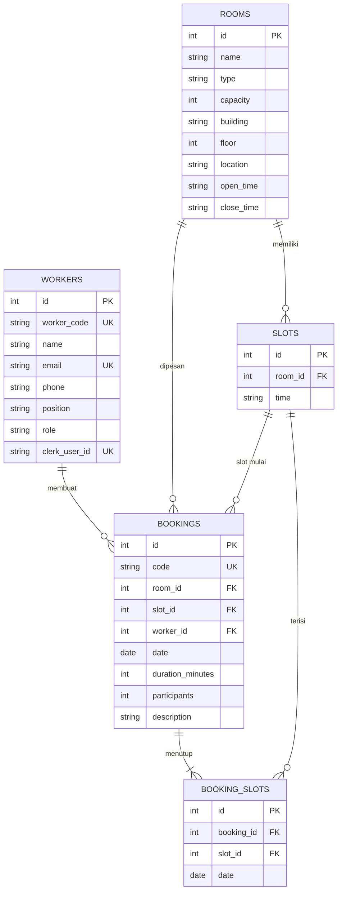

Tabel `booking_slots` memiliki constraint unik `(slot_id, date)`. Satu baris dibuat untuk setiap jam yang tertutup booking, sehingga database sendiri menolak booking ganda, termasuk saat dua request masuk bersamaan (race condition). Pembuatan booking dan seluruh barisnya berlangsung dalam satu transaksi, dan pelanggaran constraint diubah menjadi respons 409. Nama, email, dan telepon pada `bookings` adalah snapshot dari `workers` saat booking dibuat.

## Asumsi dan keputusan desain

- Booking adalah fasilitas internal tanpa biaya: harga dan paket konsumsi tidak digunakan.
- Slot berdurasi 60 menit, jam tepat; jam operasional seed adalah 08:00–21:00. Durasi booking merupakan kelipatan 60 menit.
- Konflik jadwal, kapasitas melebihi batas, dan durasi melewati jam tutup menghasilkan 409. Validasi bentuk/input menghasilkan 422.
- Identitas pemesan berasal dari worker terautentikasi. Nama, email, dan telepon disimpan pada booking sebagai snapshot; data kontak tidak dikirim dari form booking.
- Admin tidak membuat booking. Ruangan dengan booking apa pun tidak dapat dihapus (409) agar riwayat tetap utuh.
- Tanggal dan status booking memakai zona `Asia/Jakarta`; tanggal API berbentuk `YYYY-MM-DD`.
- Frontend menggunakan backend Express secara langsung. `json-server`/mode mock tidak dipakai.
- Pembatalan/perubahan booking, notifikasi, pembayaran, dan dashboard seluruh booking Admin berada di luar scope.

## Perbedaan dari kontrak soal dan alasannya

| Soal | Implementasi | Alasan |
| ---- | ------------ | ------ |
| Field harga pada ruangan (jika ada di soal awal) | Tidak ada field, kalkulasi, atau kolom harga. Ruangan memiliki tambahan `type`, `building`, `floor`, `location`, `openTime`, `closeTime`, `notes` | Fasilitas internal tanpa biaya sewa; filter Gedung dan Lantai membutuhkan data tambahan |
| Body `POST /bookings` berisi `name`, `email`, `phone` | Tidak dikirim dari frontend; server mengambilnya dari tabel `workers` lewat sesi Clerk. Ditambah `durationMinutes` dan `description` (opsional). Bila field lama tetap dikirim, diabaikan dan tetap 201 | Data pemesan sudah ada di database dan tidak boleh dipercaya dari klien |
| Slot dan booking per slot | Slot 60 menit jam tepat; booking bisa mencakup beberapa jam lewat `durationMinutes` dan tabel `booking_slots` | Pemilihan waktu lewat timeline dengan rentang bebas kelipatan 1 jam |
| Tidak ada autentikasi | Clerk; role Worker/Admin dibaca dari `workers.role` | Aplikasi internal dengan dua peran |
| Frontend di atas json-server | Frontend langsung memakai backend Express | Frontend dan backend dikerjakan bersamaan; lihat Keterbatasan |
| 409 untuk slot terisi, 422 untuk validasi | Sesuai soal; kapasitas melebihi batas dan durasi melewati jam tutup juga 409 | Mengikuti soal |

## Pengujian

Jalankan dari folder yang sesuai:

```powershell
# Backend
cd backend
npm run build
npm test

# Frontend
cd ..\frontend
npm run build
npm run lint
npm test
```

Test backend saat ini menjalankan unit test fungsi waktu booking. Test frontend adalah unit test Vitest; build memeriksa TypeScript. Pengujian alur end-to-end yang memerlukan sesi Clerk dan database harus dilakukan dengan akun dan database pengembangan.

## Troubleshooting

| Gejala | Penyebab dan solusi |
| ------ | ------------------- |
| 401 pada request API (misalnya di Postman) | Token sesi Clerk berumur pendek (kira-kira satu menit) atau tidak dikirim. Ambil token baru dan kirim sebagai `Authorization: Bearer <token>`. |
| 403 "Akun belum terdaftar sebagai worker" | Email terverifikasi akun Clerk tidak ada di tabel `workers`. Samakan dengan `SEED_WORKER_EMAIL` atau `SEED_ADMIN_EMAIL`, lalu jalankan `npm run db:seed`. |
| Error CORS di browser | `FRONTEND_ORIGIN` di `backend/.env` harus persis sama dengan origin frontend (contoh `http://localhost:5173`). |
| Migrasi gagal terhubung ke database | `DATABASE_URL` harus diawali `postgres://` atau `postgresql://`, bukan `prisma+postgres://`. |
| Peringatan SSL dari `pg` | Hanya peringatan. Tambahkan `sslmode=verify-full` pada URL untuk menghilangkannya. |
| Perintah Prisma tidak menemukan konfigurasi | Selalu tambahkan `--config prisma7.config.ts`, dan jalankan dari folder `backend`. |
| Perilaku Prisma berbeda dari yang diharapkan | Proyek memakai Prisma 7.10.x. Pasang dengan `npm ci` dan jangan upgrade ke Prisma 8. |

## Keterbatasan yang diketahui

- Route terautentikasi memerlukan database yang sudah dimigrasi, key Clerk, serta worker yang cocok dengan email terverifikasi.
- Repository tidak menyediakan json-server atau data mock; endpoint diuji melalui backend nyata.
- Suite yang tersedia tidak menggantikan pengujian integrasi race condition, autentikasi Clerk, maupun alur browser penuh pada database baru.
- Build frontend berhasil, tetapi Vite memperingatkan bahwa chunk JavaScript utama melebihi 500 kB; pemecahan chunk belum dilakukan.

## Penggunaan AI

Claude (chat) digunakan untuk merevisi PRD, merencanakan tahapan, menyusun prompt, dan membantu debugging setup Prisma, Git, serta Clerk. GitHub Copilot di VS Code digunakan untuk menulis kode backend dan frontend tahap demi tahap berdasarkan PRD. Saya menjalankan aplikasi, melakukan pengujian manual melalui Postman dan browser, meninjau perubahan, dan membuat seluruh commit.

**Yang saya kerjakan sendiri**

- Menyiapkan struktur monorepo, memasang dependensi, dan memindahkan Prisma ke versi 7.10 setelah menemukan Prisma 8 (RC) tidak cocok dengan rencana.
- Membuat aplikasi Clerk, database Prisma Postgres di Vercel, dan mengisi semua file '.env' (tidak pernah dibagikan ke alat AI maupun di-commit).
- Menjalankan migrasi dan seeder, lalu memeriksa hasilnya di Prisma Studio.
- Menguji seluruh endpoint API di Postman memakai token sesi Clerk untuk peran Worker dan Admin.
- Meninjau hasil tiap tahap, memutuskan perubahan (misalnya aturan hapus ruangan yang punya booking), dan membuat semua commit.
- Melakukan uji manual di browser untuk mengecek alur pemesanan, timeline dan Kelola Ruangan.

**Verifikasi**

Setiap tahap dibatasi oleh prompt: alat AI tidak boleh membaca '.env', mengubah skema, atau melakukan commit. Hasilnya diperiksa dengan build, lint, dan unit test. Pengujian yang memerlukan login dan database nyata dilakukan manual oleh saya.
